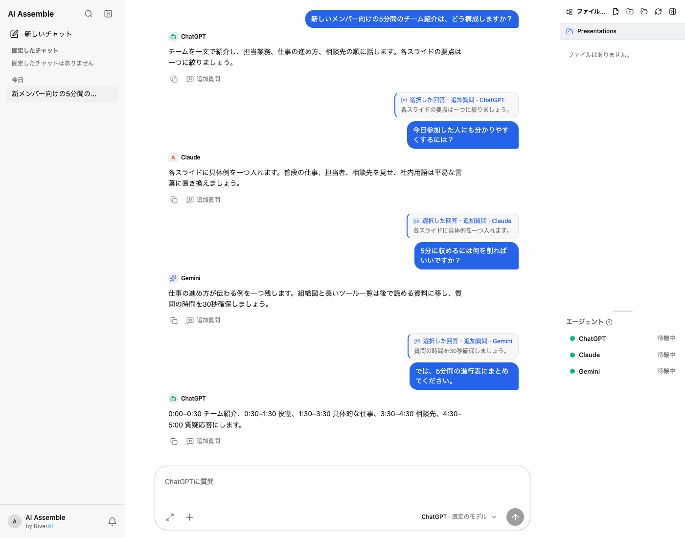

# AI Assemble

[한국어](README.ko.md) · [English](README.md) · [日本語](README.jp.md) · [製品紹介ページ](https://hello-sb-cho.github.io/ai-assemble-app/)

> 複数のAIの回答を一つの会話でつなぎ、引用して質問を続けられるデスクトップアプリ

サンプル会話データを表示した実際のアプリ画面です。

## 開発した理由

AIごとに得意な視点がありますが、ウィンドウを行き来して質問や文脈をコピーすると、会話の流れが途切れます。AI Assembleでは**質問ごとに回答するAIを選び**、以前の回答を引用して同じAIや別のAIに続けて質問できます。どの視点を深めるかは利用者が決め、アプリがその過程を一つの会話に記録します。

現在はCodex CLI経由のChatGPT、Claude Code経由のClaude、agy CLI経由のGemini、利用者が設定した互換API接続に対応しています。利用には各ツールのインストール、ログイン、設定が必要です。公開版には社内専用AI接続は含まれません。

## 使い方

1. **AIを接続:** 利用するAIの対応CLIをインストールしてログインします。アプリの**Provider設定**で接続状態とモデルを確認します。互換APIは別途追加できます。
2. **作業フォルダーを選択:** AIが参照するフォルダーを選びます。会話ごとに選択したフォルダーが記憶されます。
3. **会話を開始:** データ分類と回答するAIを選び、質問します。必要に応じてファイルを添付します。
4. **続けて質問:** 回答や選択した文章を引用し、同じAIまたは別のAIに質問します。複数のAIを選んで、それぞれの回答を受け取ることもできます。
5. **履歴を確認:** 会話一覧や検索から質問、回答、引用、追加の回答を見直せます。AI間で非公開の会話状態が自動共有されるわけではなく、アプリが必要な過去の文脈を選択したAIに渡します。

**例:** ChatGPTに5分間のチーム紹介の構成を尋ねます。「各スライドの要点は一つ」という回答を引用してClaudeに分かりやすい説明を尋ね、Claudeの「具体例を一つ」という提案を引用してGeminiに削る点を尋ねます。最後にGeminiの「質問の時間を30秒」という提案を引用し、ChatGPTに5分間の進行表を依頼します。それぞれの回答はAIの見解であり、正確性の保証ではありません。

## 安全性とセキュリティ

- **保存先:** 会話履歴は端末のアプリデータフォルダーにあるSQLiteファイルに保存されます。このファイルの暗号化を保証するものではありません。端末とバックアップへのアクセスを管理してください。
- **AIへの送信:** 回答生成のため、質問、引用、必要な過去の文脈、参照ファイルの内容が**選択したAIまたは設定したAPI接続先**に送られる場合があります。機密情報を外部AIに送る前に確認してください。
- **データ分類:** `confidential`ではポリシーチェックが外部AI呼び出しを遮断します。公開版には許可対象の社内専用AIがないため、機密会話で外部AIを利用できません。`internal`と`normal`は外部AIを許可します。分類名だけで送信が防がれるわけではありません。
- **アカウントと作業フォルダー:** ログインは各CLIが管理します。アプリは選択したフォルダーでCLIを実行するため、接続したAIツールがファイルを読み書きする場合があります。フォルダーは慎重に選んでください。
- **回答の確認:** 別のAIへの質問は自動的な事実確認ではありません。重要な主張、出典、ファイルの変更は自分で確認してください。

## プロジェクト

この公開リポジトリには紹介ページとリリースを掲載しています。アプリのソースと技術文書は非公開です。意見や不具合は[Issues](https://github.com/Hello-SB-Cho/ai-assemble-app/issues)へ。個人の会話やアカウント情報は添付しないでください。
