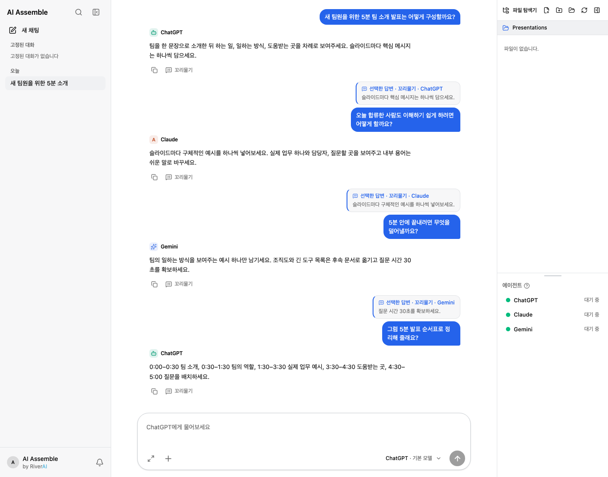

# AI Assemble

[한국어](README.ko.md) · [English](README.md) · [日本語](README.jp.md) · [제품 소개 페이지](https://hello-sb-cho.github.io/ai-assemble-app/)

> 여러 AI의 답을 한 대화에서 이어 읽고, 인용하고, 다시 묻는 데스크톱 앱

예시 대화 데이터로 렌더링한 실제 앱 화면입니다.

## 왜 만들었나요?

AI마다 강점이 다르지만, 답변을 비교하려고 창을 옮기며 질문과 맥락을 복사하면 대화 흐름이 끊깁니다. AI Assemble는 **질문마다 답할 AI를 고르고**, 이전 답변의 일부를 인용해 같은 AI나 다른 AI에게 후속 질문을 할 수 있도록 만들었습니다. 사용자가 어떤 관점을 더 살필지 결정하며, 앱은 그 과정을 한 대화에 기록합니다.

현재 앱은 ChatGPT(Codex CLI), Claude(Claude Code), Gemini(agy CLI) 및 사용자가 설정한 호환 API 연결을 지원합니다. 각 연결의 사용 가능 여부는 설치·로그인 상태와 설정에 따라 달라집니다. 공개 배포 버전에는 사내 전용 AI 연결이 포함되지 않습니다.

## 사용법

1. **AI 연결 준비:** 사용할 AI의 지원 CLI를 설치하고 해당 서비스에 로그인합니다. 앱의 **Provider 설정**에서 연결 상태와 모델을 확인합니다. 호환 API를 사용한다면 별도로 연결을 추가합니다.
2. **작업 폴더 선택:** 앱에서 AI가 참고할 작업 폴더를 고릅니다. 대화별로 사용한 폴더가 기억됩니다.
3. **대화 시작:** 새 대화에서 데이터 등급과 답할 AI를 선택한 뒤 질문합니다. 필요하면 파일을 첨부합니다.
4. **꼬리물기:** 답변이나 문장을 인용하고 후속 질문을 적습니다. 같은 AI 또는 다른 AI를 선택할 수 있습니다. 여러 AI를 선택해 각각의 답을 받아볼 수도 있습니다.
5. **기록 확인:** 대화 목록과 검색에서 질문, 답변, 인용, 후속 답변을 다시 확인합니다. 다른 AI의 숨겨진 대화 상태가 자동 공유되는 것은 아닙니다. 앱이 필요한 이전 맥락을 구성해 선택한 AI에 전달합니다.

기본 CLI Provider의 답변은 **요청당 최대 30분**까지 기다립니다. 별도로 설정한 API 연결은 제한 시간이 다를 수 있습니다. 응답 중에는 대화에서 중지할 수 있습니다.

**예시:** ChatGPT에 5분 팀 소개 발표 구성을 묻습니다. “슬라이드마다 핵심 메시지 하나”라는 답을 인용해 Claude에 새 팀원에게 쉽게 설명하는 법을 묻고, Claude의 “구체적인 예시”를 인용해 Gemini에 시간을 맞추려면 무엇을 덜어낼지 묻습니다. 마지막으로 Gemini의 “질문 시간 30초”를 인용해 ChatGPT에 5분 순서표를 요청합니다. 각 답변은 해당 AI의 관점이며, 사실 검증을 보증하지 않습니다.

## 안전과 보안

- **저장 위치:** 대화 기록은 사용자 기기의 앱 데이터 폴더에 SQLite 파일로 저장됩니다. 이 저장 파일의 암호화를 보장하는 기능으로 소개하지 않습니다. 기기 접근 권한과 백업을 관리해 주세요.
- **외부 전달:** 질문, 인용 내용, 필요한 이전 맥락과 참조 파일 내용은 답을 생성하는 **선택한 AI 또는 설정한 API 주소**로 전달될 수 있습니다. 외부 AI에 보내기 전 민감한 내용을 확인해 주세요.
- **데이터 등급:** `기밀(confidential)` 대화는 외부 AI 호출을 정책 검사에서 차단합니다. 공개 배포 버전에는 허용되는 사내 전용 AI가 없어 기밀 등급으로 외부 AI와 대화할 수 없습니다. `내부(internal)`과 `일반(normal)`은 외부 AI 사용을 허용하므로 등급만으로 반출을 막지는 않습니다.
- **계정과 작업 폴더:** 지원 CLI의 로그인은 각 도구에서 관리합니다. 앱은 선택한 작업 폴더에서 CLI를 실행하므로, 연결된 AI 도구가 폴더의 파일을 읽거나 변경할 수 있습니다. 접근을 허용할 폴더를 신중히 고르세요.
- **답변 검토:** 다른 AI에게 되묻는 기능은 자동 사실 검증이 아닙니다. 중요한 결정에는 원문, 출처, 파일 변경 사항을 직접 확인하세요.

## 프로젝트 안내

이 공개 저장소에는 소개 페이지와 릴리스가 있습니다. 앱 소스와 기술 문서는 비공개로 유지합니다. 문제 제안은 [공개 Issues](https://github.com/Hello-SB-Cho/ai-assemble-app/issues)에 남길 수 있습니다. 개인 대화나 계정 정보는 첨부하지 마세요.
