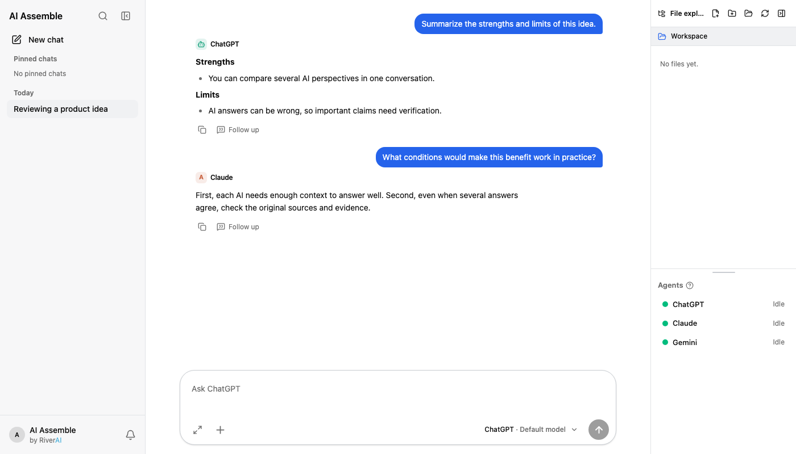

# AI Assemble

[한국어](README.ko.md) · [English](README.md) · [日本語](README.jp.md) · [Project website](https://hello-sb-cho.github.io/ai-assemble-app/)

> A desktop app for continuing one conversation across multiple AI tools

Actual app interface with sample conversation data.

## Why we built it

Different AI tools can offer different perspectives, but copying questions and context between windows breaks the flow. AI Assemble lets you **choose the AI for each question**, quote a previous answer, and ask a follow-up to the same or another AI. You decide which perspective to explore; the app keeps the conversation together.

The current app supports ChatGPT through Codex CLI, Claude through Claude Code, Gemini through agy CLI, and user-configured compatible API endpoints. Availability depends on each tool's installation, sign-in, and settings. The public build does not include the internal-only AI connection.

## How to use it

1. **Connect an AI:** Install and sign in to the supported CLI for each AI you want to use. Check the connection and model in **Provider settings**. Add a compatible API endpoint separately if needed.
2. **Choose a workspace:** Select the folder the AI may use for context. The app remembers the folder for each conversation.
3. **Start a conversation:** Choose a data classification and an AI, then ask a question. Attach files when needed.
4. **Ask follow-ups:** Quote an answer or selected text and ask the same or a different AI. You can also select multiple AIs to receive separate responses.
5. **Review the record:** Reopen questions, answers, quotes, and follow-ups from the conversation list or search. Hidden conversation state is not automatically shared between AI tools; the app sends the needed prior context to the selected one.

**Example:** Ask ChatGPT for the strengths and weaknesses of a design. Quote one sentence and ask Claude what assumptions it misses. Then ask Gemini which claims need verification. These are independent AI responses, not a guarantee of factual accuracy.

## Safety and security

- **Local records:** Conversations are stored in a SQLite file in the app data directory on your device. The app does not claim to encrypt that file; protect access to your device and backups.
- **Data sent to AI:** Your question, quotes, relevant earlier context, and contents of referenced files may be sent to the **selected AI or configured API endpoint** to generate an answer. Check sensitive material before sending it to an external AI.
- **Classification:** The `confidential` setting blocks calls to external AIs at the policy check. The public build has no permitted internal-only AI, so confidential conversations cannot use an external AI. `internal` and `normal` allow external AI calls; their labels alone do not prevent disclosure.
- **Accounts and workspace:** Each supported CLI manages its own sign-in. The app runs the CLI in your selected workspace, where the connected AI tool may read or change files. Choose that folder carefully.
- **Review answers:** Asking another AI is not automatic fact-checking. Verify important claims, sources, and file changes yourself.

## Project

This public repository contains the website and releases. The app source and technical documentation remain private. Share feedback in [Issues](https://github.com/Hello-SB-Cho/ai-assemble-app/issues) without attaching private conversations or account information.
